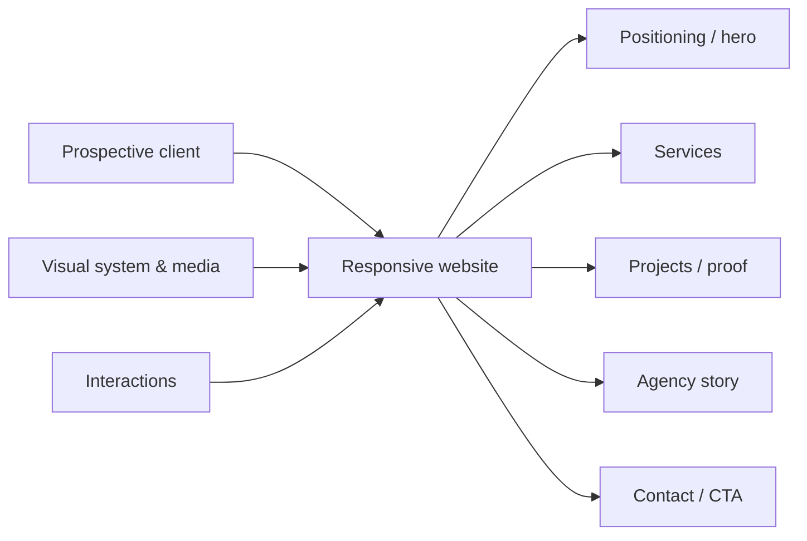
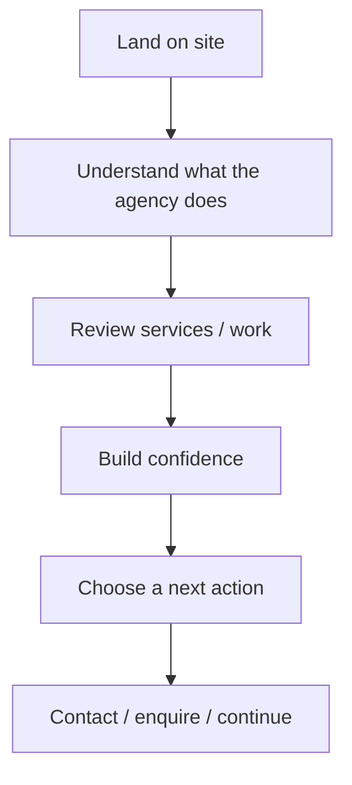
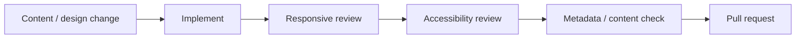

<div align="center">

# Creative Agency

**A responsive creative-agency website project for presenting services, work, brand personality, and clear contact paths.**


[Browse website](./site) · [Technical README](./site/README.md) · [Issues](https://github.com/Nischhalsubba/Creative-Agency/issues)

</div>

## Overview

**Creative Agency** is documented as a public-facing website experience: help visitors understand the agency, scan services and work, build confidence, and reach a useful next action without fighting the interface.

| Audience | Focus |
|---|---|
| Visitors / clients | Services, work, credibility and contact |
| Developers | Page structure, interactions, assets and delivery |
| Designers | Brand expression, hierarchy, responsive behavior and motion |
| Content teams | Clear positioning, case-study copy, metadata and calls to action |

<details open>
<summary><strong>🏗️ Interactive website architecture</strong></summary>



</details>

## Visitor flow



## Repository map

```text
Creative-Agency/
├── .github/   # automation
├── site/      # maintained website and deeper docs
└── README.md  # project overview
```

## Getting started

```bash
git clone https://github.com/Nischhalsubba/Creative-Agency.git
cd Creative-Agency/site
```

Use the runtime and package manager declared by the files under `site/`. Detailed technical notes belong in [`site/README.md`](./site/README.md).

## Design & accessibility

Keep brand expression subordinate to comprehension. Preserve readable typography, useful spacing, visible focus, keyboard access, responsive layouts, reduced-motion behavior when motion exists, meaningful image alternatives, and clear CTA hierarchy.

## SEO & discoverability

For a public agency site, prioritize accurate **creative agency, design services, digital services, portfolio, case study, and contact** language only where it reflects real content. Use unique titles/descriptions, semantic headings, descriptive internal links, Open Graph metadata, canonical URLs, accessible images, and structured organization/project data where appropriate.

## Contribution flow


